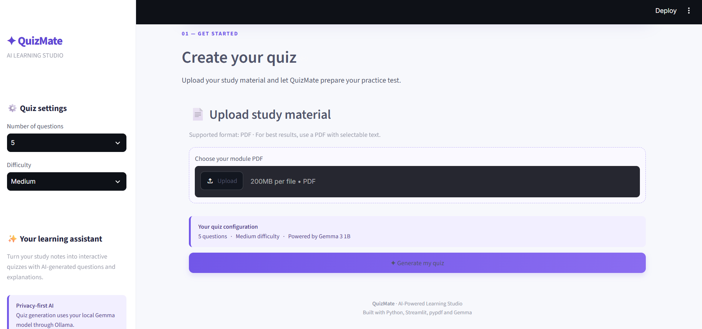
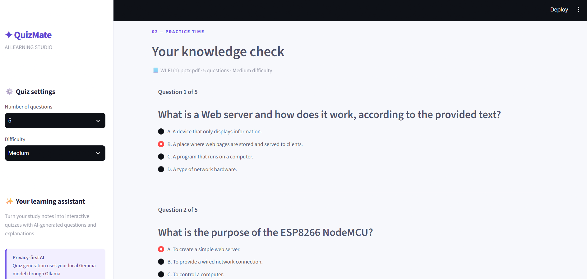

# QuizMate — AI-Powered Module Quiz Generator

QuizMate is an AI-powered web application that generates multiple-choice questions (MCQs) from uploaded PDF study materials. Built using Python, Streamlit, Ollama, and Gemma 3 1B, it helps students test their knowledge, evaluate their performance, and revise important concepts interactively.

## ✨ Features

- 📄 **PDF Text Extraction:** Extracts readable text from uploaded PDF documents.
- 🤖 **AI-Powered Quiz Generation:** Uses the Gemma 3 1B language model through Ollama to generate quiz questions.
- ⚙️ **Customizable Quiz Settings:** Select the number of questions and difficulty level.
- 📝 **Interactive MCQs:** Answer questions with four options (A, B, C, and D).
- 📊 **Automatic Evaluation:** Calculates the score and percentage after submission.
- 💡 **Answer Explanations:** Displays correct answers and explanations to support learning.
- 🔒 **Local AI Processing:** Runs the language model locally through Ollama.
- 🎨 **User-Friendly Interface:** Provides a clean, responsive interface built with Streamlit.

---

## 🖥️ Application Screenshots

The following screenshots demonstrate the main features of QuizMate.

### 1. Home Page

The home page introduces QuizMate and provides the PDF uploader and quiz configuration settings.



### 2. Generated Quiz

This screen displays the multiple-choice questions generated from the uploaded study material.



### 3. Quiz Results

After submitting the quiz, users can view their score, percentage, and explanations for the answers.


---

## 🛠️ Technologies Used

| Technology | Purpose |
|---|---|
| Python | Core programming language |
| Streamlit | Web application interface |
| Ollama | Runs the local AI model |
| Gemma 3 1B | Generates quiz questions |
| pypdf | Extracts text from PDF documents |
| Git and GitHub | Version control and project hosting |

---

## 📁 Project Structure

```text
QuizMate/
├── app.py
├── gemma.py
├── pdf_utils.py
├── requirements.txt
├── README.md
├── .gitignore
└── screenshots/
    ├── home.png
    ├── quiz.png
    └── results.png
```

---

## ⚙️ Installation and Setup

### Prerequisites

Make sure you have the following installed:

- Python
- Git
- Ollama

### Step 1: Clone the repository

```bash
git clone https://github.com/sahilwadekar774/QuizMate.git
cd QuizMate
```

### Step 2: Create a virtual environment

```bash
python -m venv .venv
```

### Step 3: Activate the virtual environment

For Windows PowerShell:

```powershell
.\.venv\Scripts\Activate.ps1
```

### Step 4: Install the required Python packages

```bash
python -m pip install -r requirements.txt
```

### Step 5: Download the Gemma model

Install Ollama from [https://ollama.com/](https://ollama.com/), then run:

```bash
ollama pull gemma3:1b
```

### Step 6: Run QuizMate

```bash
python -m streamlit run app.py
```

Open the local URL displayed in the terminal. It is usually:

`http://localhost:8501`

---

## 🚀 How to Use QuizMate

1. Start the QuizMate application.
2. Upload a PDF containing readable study material.
3. Choose the desired number of questions and difficulty level.
4. Click **Generate Quiz**.
5. Select an answer for each question.
6. Submit your answers to evaluate your performance.
7. Review your score and the explanations provided.

---

## 🧠 How It Works

1. **PDF Upload:** The user uploads a PDF through the Streamlit interface.
2. **Text Extraction:** The pypdf library extracts readable text from the document.
3. **Prompt Creation:** The extracted text and quiz settings are sent to the Gemma model.
4. **AI Quiz Generation:** Ollama runs Gemma locally to generate MCQs in JSON format.
5. **Quiz Display:** Streamlit displays the generated questions and answer options.
6. **Evaluation:** The application checks submitted answers and calculates the score.
7. **Feedback:** The user receives the result and explanations for the questions.

---

## 🔐 Privacy and Limitations

- The language model runs locally through Ollama.
- QuizMate requires Ollama and the Gemma model to be installed and available.
- The application needs readable text in the PDF; scanned documents may require OCR.
- The accuracy and quality of generated questions depend on the source material and model output.
- AI-generated answers should be reviewed for correctness.

---

## 🔮 Future Enhancements

- Export generated quizzes to PDF.
- Save quiz history and performance statistics.
- Support additional AI models.
- Add timed quizzes and more question formats.
- Support scanned PDFs using OCR.
- Introduce topic-wise quiz generation and difficulty adaptation.

---

## 👨‍💻 Author

**Sahil Wadekar**

GitHub: [@sahilwadekar774](https://github.com/sahilwadekar774)

## 📌 Project Repository

[https://github.com/sahilwadekar774/QuizMate](https://github.com/sahilwadekar774/QuizMate)

---

*QuizMate — Turn your study material into interactive quizzes.*